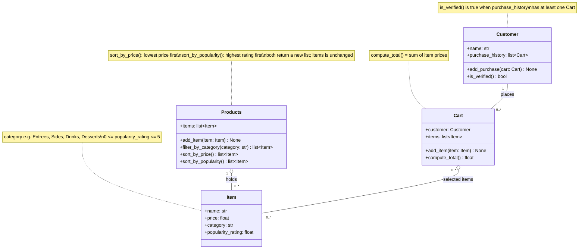

# ByteBites UML Design

## Class summaries

- **Customer**: a user of the app, identified by name. Their past Carts show they are a real user, and one past purchase is enough to count as verified.
- **Item**: one food or drink for sale, with a name, price, category (a plain string such as "Drinks" or "Desserts"), and a popularity rating from 0 to 5 stars.
- **Products**: the full menu of Items, which can be filtered by category and sorted by price or popularity.
- **Cart**: one transaction that belongs to one Customer. It holds the Items they picked and computes the total as the sum of their prices.
