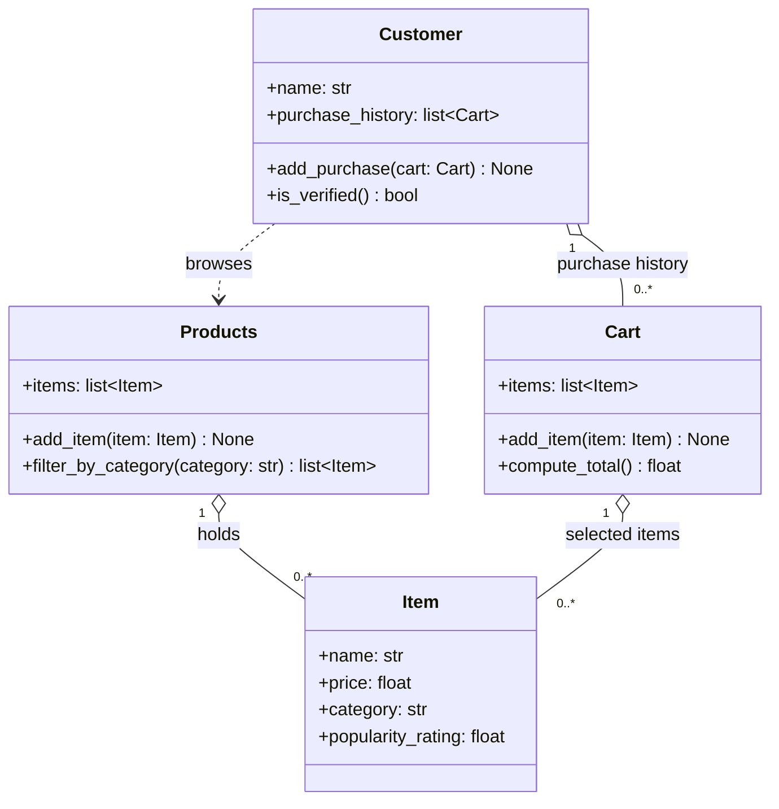

# ByteBites UML Draft (no reference file)



## Plain-text version

```
+---------------------------+        +---------------------------+
|         Customer          |        |         Products          |
+---------------------------+        +---------------------------+
| name: str                 |browses | items: list[Item]         |
| purchase_history:         |------->+---------------------------+
|     list[Cart]            |        | add_item(item)            |
+---------------------------+        | filter_by_category(cat)   |
| add_purchase(cart)        |        |     -> list[Item]         |
| is_verified() -> bool     |        +-------------+-------------+
+-------------+-------------+                      | 1
              | 1                                  |
              | purchase history                   | holds
              | 0..*                               | 0..*
+-------------+-------------+        +-------------+-------------+
|           Cart            |        |           Item            |
+---------------------------+  0..*  +---------------------------+
| items: list[Item]         |------->| name: str                 |
+---------------------------+        | price: float              |
| add_item(item)            |        | category: str             |
| compute_total() -> float  |        | popularity_rating: float  |
+---------------------------+        +---------------------------+
```

## Class summaries

- **Customer**: a user of the app, identified by name, whose past Carts show they are a real user.
- **Item**: one food or drink for sale, with a name, price, category, and popularity rating.
- **Products**: the full menu of Items, which can be filtered by category.
- **Cart**: one transaction, holding the Items a customer picked and computing their total cost.
